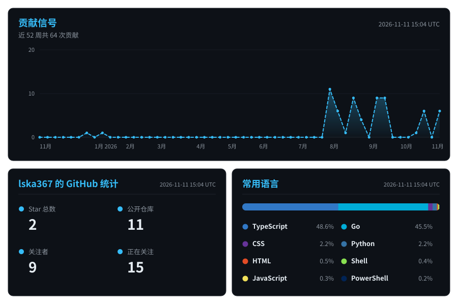
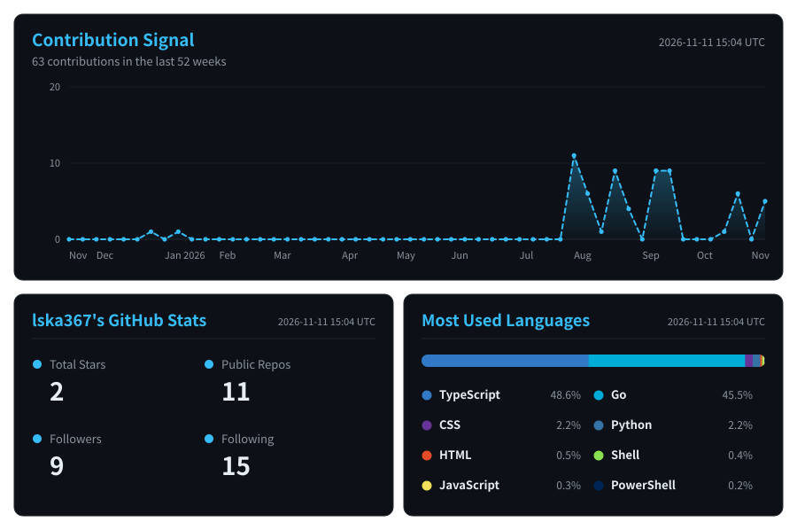

<picture>
  <source media="(prefers-color-scheme: dark)" srcset="assets/banner-dark.svg">
  
</picture>

**✨ Make AI usable everywhere 🌍**

> 🎓 **华东师范大学 · 人工智能硕士在读**（2026.09 –）
>
> 💼 **字节跳动 · 国际化广告与交易部门** — 大数据开发实习生（2026.11 –）｜ TikTok 广告转化归因算法与数据链路优化

## 🎓 学习经历

| 阶段 | 学校 | 专业 | 时间 |
|:----:|------|------|------|
| 硕士 | **华东师范大学** · 计算机科学与技术学院 | 人工智能（保研） | 2026.09 – |
| 本科 | **东北林业大学** · 计算机与人工智能学院 | 数据科学与大数据技术 | 2022 – 2026 |

## 🚀 项目

### 🔍 [vllm-sniffer](https://github.com/lska367/vllm-sniffer) &nbsp;   

**非侵入式 vLLM 运行时 tracer** — 观测调度 / 前向 / 采样 / KV cache 压力，定位 `temp=0` 输出不一致的浮点根因；含分析工具（parquet / TTFT / flip 归因）与可视化前端。

零行为侵入 · 当前主力 · [源码仓库 →](https://github.com/lska367/vllm-sniffer)

### 📓 [kvcache_research](https://github.com/lska367/kvcache_research) &nbsp;  

**KV Cache 研究笔记** — 论文精读、测量与复现记录，整理中。

可复现实验 · [源码仓库 →](https://github.com/lska367/kvcache_research)

## 🔭 目前在做

- **广告转化归因与数据链路** — TikTok 广告业务的归因算法迭代与数据链路优化（字节跳动实习）
- **KV Cache 量化 + 分层调度策略** — 做可复现的系统设计
- **分布式 LLM 推理与训练** — Ray（Core / Train / Data）、vLLM 源码级调优
- **Kubernetes 分布式推理部署** — vLLM + Mooncake（KV Cache 跨节点传输）容器化实践

## 💼 工作经历

- **字节跳动 · 国际化广告与交易部门** — *大数据开发实习生* ｜ `2026.11 –`
  - 负责 TikTok 广告业务的转化归因算法与数据链路优化
- **益普索（中国）咨询有限公司 · AI Lab** — *AI 算法实习生* ｜ `2025.12 – 2026.02`

## 🌱 技术栈

| 方向 | 技术 |
|:--:|:--:|
| **Data Engineering** |      |
| **LLM Inference** |    |
| **Distributed** |   |
| **Deep Learning** |    |
| **LLM Apps** |    |
| **Storage & Systems** |        |

## 📈 活跃度信号

## 🏆 荣誉

- 东北林业大学 2025 年度 **国家励志奖学金**

## 📫 联系

📧 [yangkamboy@outlook.com](mailto:yangkamboy@outlook.com) ｜ 📝 [个人博客](https://lska367.github.io) ｜ 欢迎交流 LLM 推理优化 / 大数据开发相关想法

 

<!-- ================================================================ -->
<!--                           English Version                         -->
<!-- ================================================================ -->

<b>🇬🇧 English version</b>

 

## Hi there 👋 I'm Kai Yang (lska367)

**✨ Make AI usable everywhere 🌍**

> 🎓 **M.S. in Artificial Intelligence** · East China Normal University (2026.09 –)
>
> 💼 **Big Data Development Intern** · ByteDance, International Ads & Transactions (2026.11 –) — TikTok Ads conversion attribution & data pipelines

## 🎓 Education

| Degree | School | Major | Period |
|:------:|--------|-------|--------|
| M.S. | **East China Normal University** · School of Computer Science and Technology | Artificial Intelligence *(recommended admission)* | 2026.09 – |
| B.S. | **Northeast Forestry University** · School of Computer and Artificial Intelligence | Data Science and Big Data Technology | 2022 – 2026 |

## 🚀 Projects

### 🔍 [vllm-sniffer](https://github.com/lska367/vllm-sniffer) &nbsp;   

**Non-intrusive vLLM runtime tracer** — observes scheduling / forward / sampling / KV-cache pressure and root-causes `temp=0` output divergence; ships analysis tools (parquet / TTFT / flip attribution) and an offline webapp.

Zero behavior change · main project · [Repository →](https://github.com/lska367/vllm-sniffer)

### 📓 [kvcache_research](https://github.com/lska367/kvcache_research) &nbsp;  

**KV-cache research notes** — paper reading, measurements and reproduction logs, work in progress.

Reproducible experiments · [Repository →](https://github.com/lska367/kvcache_research)

## 🔭 Currently

- **Ads conversion attribution & data pipelines** — attribution algorithms and pipeline optimization for TikTok Ads (ByteDance internship)
- **KV cache quantization + layer-wise scheduling** — reproducible system design
- **Distributed LLM inference & training** — Ray (Core / Train / Data), vLLM source-level tuning
- **Kubernetes for distributed inference** — containerized vLLM + Mooncake (cross-node KV cache transfer)

## 💼 Experience

- **ByteDance · International Ads & Transactions** — *Big Data Development Intern* ｜ `2026.11 –`
  - Conversion attribution algorithms and data pipeline optimization for TikTok Ads
- **Ipsos (China) · AI Lab** — *AI Algorithm Intern* ｜ `2025.12 – 2026.02`

## 🌱 Tech Stack

| Area | Stack |
|:--:|:--:|
| **Data Engineering** |      |
| **LLM Inference** |    |
| **Distributed** |   |
| **Deep Learning** |    |
| **LLM Apps** |    |
| **Storage & Systems** |        |

## 📊 Activity Signal

## 🏆 Honors

- Northeast Forestry University **National Inspirational Scholarship** (2025)

## 📫 Contact

📧 [yangkamboy@outlook.com](mailto:yangkamboy@outlook.com) ｜ 📝 [Blog](https://lska367.github.io) ｜ Open to discuss LLM inference optimization / big data engineering

---

---

© 2026 Kai Yang · 杨锴

